# Telco Customer Churn Analysis (SQL Server + Python)

Which customers leave a telecom company, why, and how much revenue does it cost? This project answers those questions with **SQL Server** for the analysis queries and **Python (pandas, scikit-learn)** for exploration, statistics and a baseline prediction model.

**Headline result:** 26.54% of customers churn, and they take 30.50% of monthly revenue with them. Contract type, customer tenure, internet service type and payment method explain most of the difference between customers who stay and customers who leave.

---

## 1. Business questions

1. What is the overall churn rate, and how much monthly revenue does churn cost?
2. Which customer segments churn the most (contract, tenure, internet service, payment method, demographics)?
3. Do add-on services such as Online Security and Tech Support go with lower churn?
4. Which customers should a retention team focus on first?

## 2. Dataset

- **Source:** IBM Telco Customer Churn dataset (available on Kaggle).
- **Size:** 7,043 customers, 21 columns, one row per customer.
- **Target:** `Churn` (Yes / No). 1,869 customers churned.
- **Features:** demographics (gender, senior citizen, partner, dependents), account details (tenure, contract, payment method, paperless billing), services (phone, internet, add-ons, streaming) and charges (`MonthlyCharges`, `TotalCharges`).

**Data cleaning:** 11 rows have a blank `TotalCharges`. All of them are brand-new customers with `tenure = 0` who have not been billed yet, so the value is stored as `NULL` (SQL) / `NaN` (pandas) instead of being guessed. There are no duplicate customer IDs.

## 3. Tools

| Area | Tools |
|---|---|
| Database and queries | SQL Server, SSMS (T-SQL: CTEs, window functions, conditional aggregation) |
| Analysis | Python, pandas, NumPy |
| Visualisation | matplotlib |
| Statistics and modelling | SciPy, scikit-learn (logistic regression) |
| Editor | VS Code with Jupyter |

## 4. Project structure

```
Customer_Behavior_Analysis/
├── README.md
├── data/
│   └── WA_Fn-UseC_-Telco-Customer-Churn.csv
├── sql/
│   ├── 01_load_telco_churn.sql      # creates database + table with proper data types, loads the CSV
│   └── 02_churn_analysis.sql        # 12 analysis queries
├── python/
│   └── telco_churn_analysis.ipynb   # cleaning, charts, statistical tests, baseline model
└── screenshots/
    ├── python_results/          # charts and number outputs from the notebook
    └── sql_results/             # SQL Server query results
```

## 5. How to run

### SQL Server

1. Put the CSV where SQL Server can read it, for example `C:\data\`.
2. Open `sql/01_load_telco_churn.sql` in SSMS and set `@FilePath` at the top to the full path of the CSV.
3. Press **F5**. The script creates the `TelcoChurn` database, builds `dbo.telco_churn` with proper data types and loads the data. It is safe to re-run.
4. The last query is a sanity check. Expected output: `7043 | 1869 | 11 | 7043`.
5. Open `sql/02_churn_analysis.sql` and press **F5** to run the analysis queries.

Requires SQL Server 2017 or later.

### Python

1. Install the libraries: `pip install pandas numpy matplotlib scipy scikit-learn jupyter`
2. Open `python/telco_churn_analysis.ipynb` in VS Code or Jupyter.
3. Check `CSV_PATH` in the second code cell. It is set to `../data/WA_Fn-UseC_-Telco-Customer-Churn.csv`, which works when the notebook is run from the `python/` folder.
4. Run all cells.

---

## 6. Key findings

| # | Finding | Evidence |
|---|---|---|
| 1 | Overall churn is 26.54% | 1,869 of 7,043 customers |
| 2 | Contract type is the strongest driver | Month-to-month 42.71%, one year 11.27%, two year 2.83% |
| 3 | New customers are the most at risk | 47.44% churn in the first 12 months vs 9.51% after 49+ months. 55.48% of all churners left within their first year |
| 4 | Fiber optic customers churn far more than DSL | Fiber 41.89%, DSL 18.96%, no internet 7.40% |
| 5 | Electronic check payers churn the most | Electronic check 45.29% vs credit card (automatic) 15.24% |
| 6 | Add-on services go with much lower churn | Online Security: 14.61% with vs 41.77% without. Tech Support: 15.17% vs 41.64% |
| 7 | Churned customers pay more | Average monthly charge 74.44 (churned) vs 61.27 (retained). Churn removes 30.50% of monthly revenue while losing 26.54% of customers |
| 8 | Seniors, single customers and customers without dependents churn more | Senior citizens 41.68% vs 23.61%. No partner 32.96% vs 19.66%. No dependents 31.28% vs 15.45% |
| 9 | One combination stands out as the highest risk | Month-to-month + fiber optic + electronic check: 1,307 customers, **60.37%** churn |

---

## 7. SQL analysis

`sql/02_churn_analysis.sql` contains 12 queries. The most important ones are shown here, with the expected result.

**Load check**

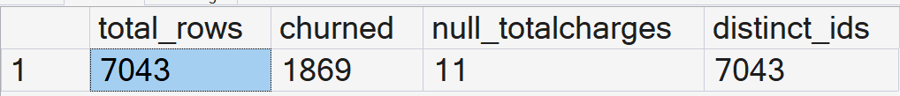

**Q1. Overall churn:** 7,043 customers, 1,869 churned, 26.54%.

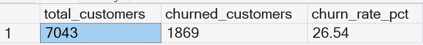

**Q2. Churn by contract type**

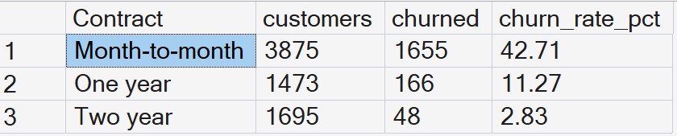

**Q3. Churn by tenure band**

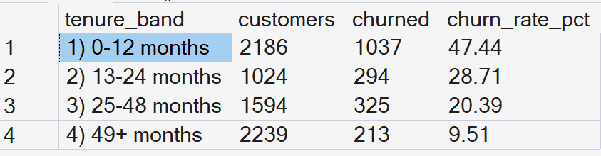

**Q6. Add-on services (internet customers only)**

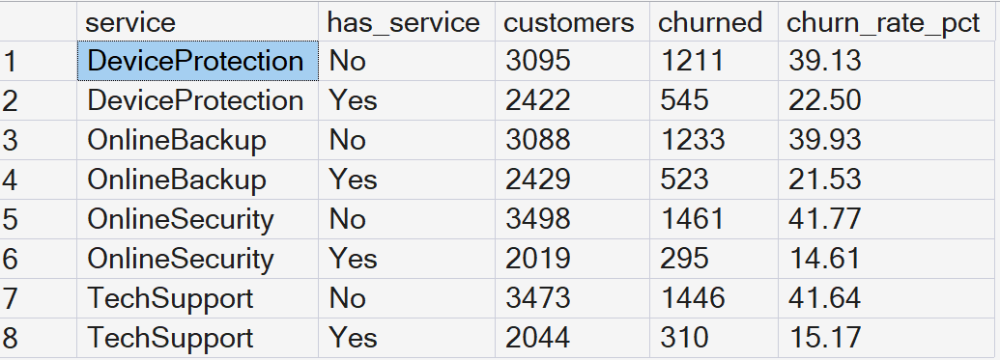

**Q8. Share of monthly revenue lost to churn:** 139,130.85 of 456,116.60, which is 30.50%.

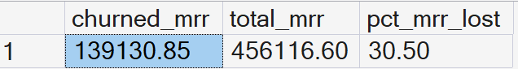

**Q10. Highest-risk segments (contract x internet service, ranked with a window function)**

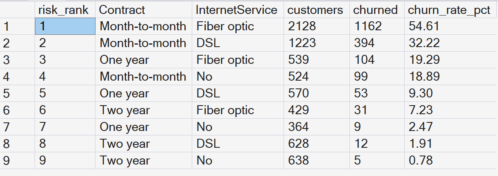

**Q11. The highest-risk profile**

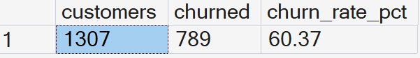

Other queries in the file: Q4 (internet service), Q5 (payment method), Q7 (revenue by churn status), Q9 (demographics) and Q12 (share of churners lost in the first 12 months).

---

## 8. Python analysis

The notebook repeats the segment analysis in pandas (the numbers match the SQL results), adds charts, runs statistical tests and fits a baseline model.

**Overall churn:** 7,043 customers, 1,869 churned, 26.54%.

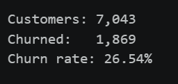

**Churn by contract, internet service, payment method and tenure**

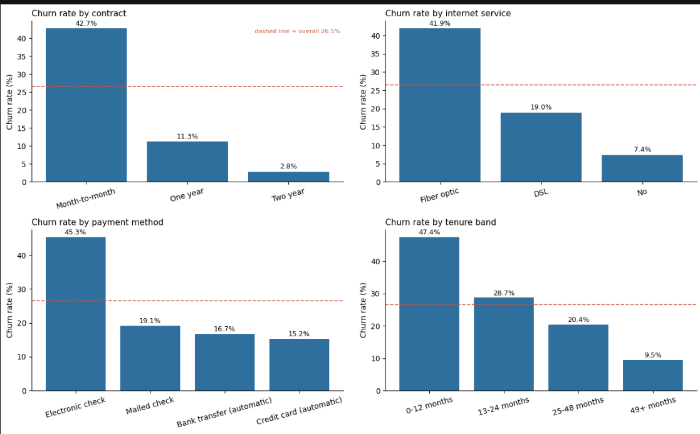

**Add-on services**

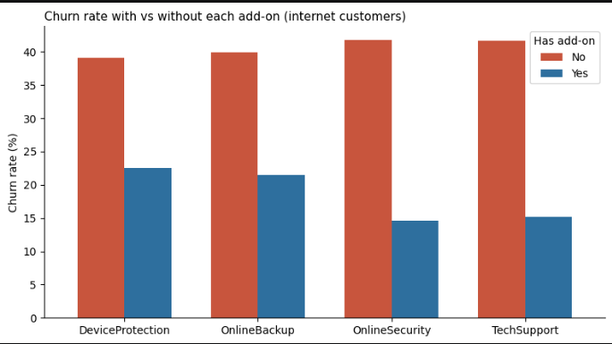

**Contract x internet service heatmap**

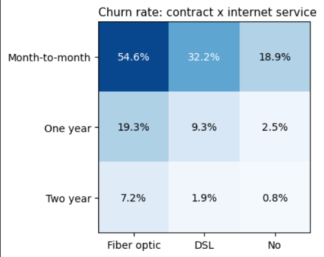

**Highest-risk segments, ranked**

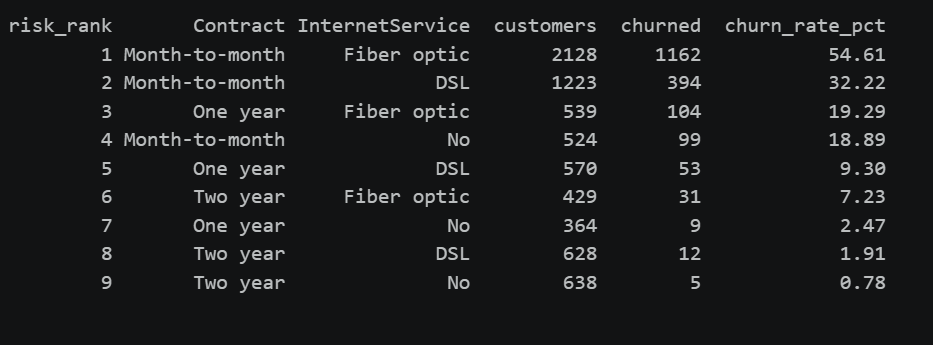

**Highest-risk profile and early-life churn:** month-to-month + fiber optic + electronic check customers churn at 60.37%, and 55.48% of all churners leave within their first 12 months.

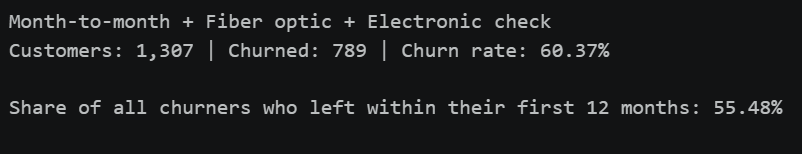

**Revenue impact:** churned customers pay more per month (74.44 vs 61.27), and churn removes 30.50% of monthly revenue.

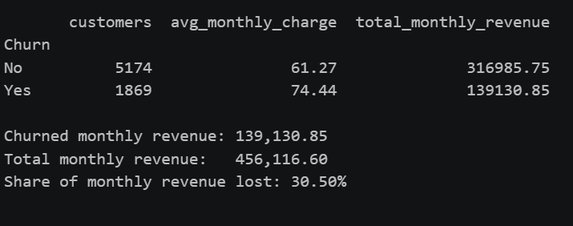

**Tenure and monthly charges**

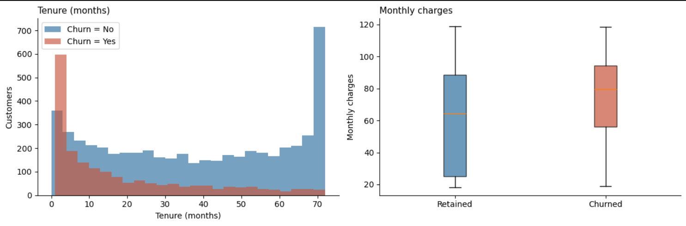

**Statistical tests:** the differences are not random noise. A chi-square test of contract type against churn gives p < 0.001, and Mann-Whitney tests show churned and retained customers differ significantly in both tenure and monthly charges (both p < 0.001).

**Baseline model:** a logistic regression (75/25 stratified split) reaches **ROC AUC of about 0.85 and accuracy of about 0.80**. For churned customers, precision is 0.65 and recall is 0.55.

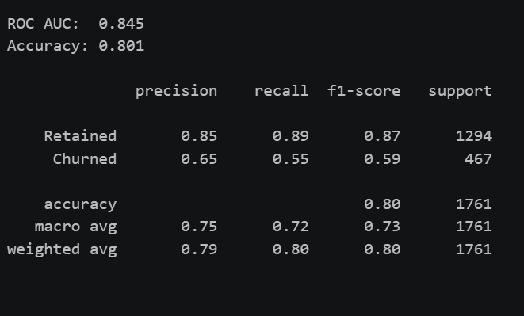

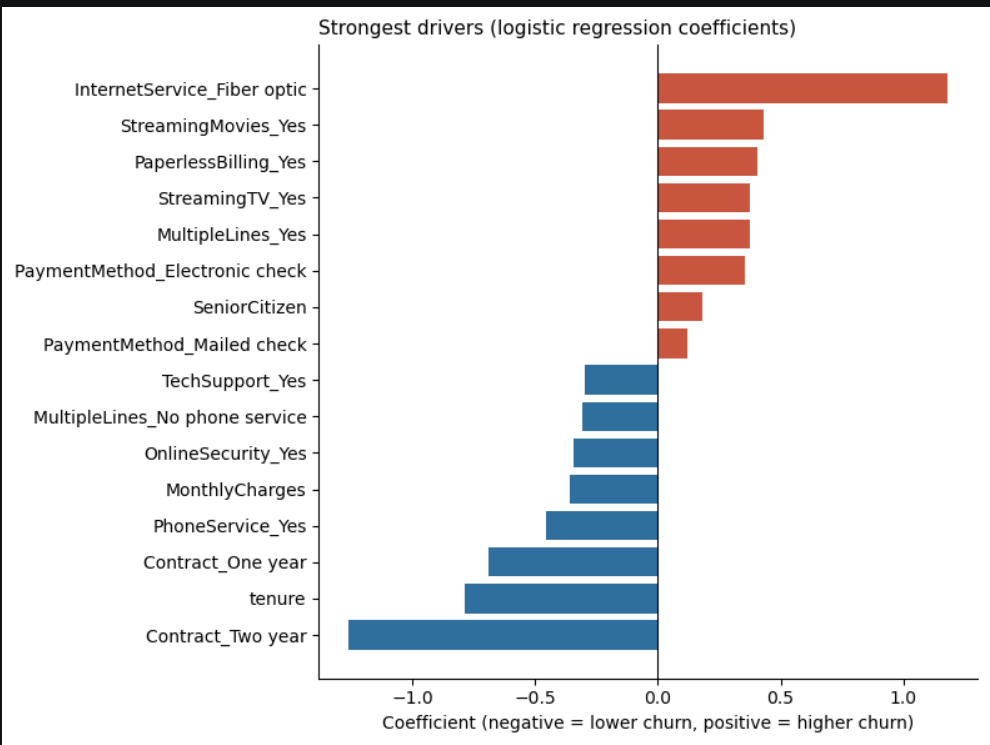

> The coefficient chart shows which customer traits are associated with churn, not what causes it. For example, streaming services rank high mostly because they go together with fiber plans and higher monthly bills.

---

## 9. Recommendations

1. **Move customers off month-to-month contracts.** Offer a discount or perk for a one-year contract. Month-to-month churn is nearly four times the one-year rate.
2. **Invest in the first year.** More than half of churners leave in the first 12 months. A welcome call, a check-in at month 3 and a check-in at month 6 would target the riskiest period.
3. **Bundle Online Security and Tech Support with fiber plans.** Fiber customers churn the most, and customers with these add-ons churn at about a third of the rate.
4. **Move electronic-check customers to automatic payment.** A small incentive for switching to bank transfer or card could help, since those customers churn at roughly a third of the electronic-check rate.
5. **Run a priority retention campaign** for month-to-month, fiber, electronic-check customers (1,307 customers, 60.37% churn).

## 10. Limitations

- The data is a single snapshot, so the analysis shows association, not cause. For example, add-on customers may simply be more engaged to begin with.
- Churn reasons, competitor pricing and customer satisfaction scores are not in the dataset.
- The model is a simple baseline built to understand the drivers, not a tuned production model.

## 11. Author

Reshma Shaik
LinkedIn link: (https://www.linkedin.com/in/reshma-shaik-521268427)  | GitHub link: (https://github.com/Reshma-0310)
